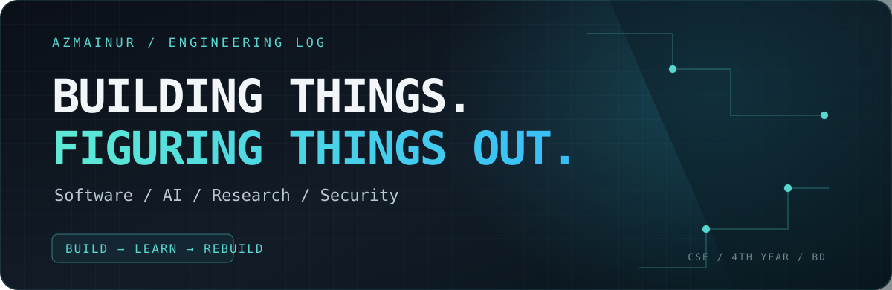

 

---

### `01 / THE PERSON BEHIND THE CODE`

I'm **Kazi Azmainur Rahman** — a 4th-year Computer Science & Engineering student at Southeast University, Bangladesh.

I like taking an idea from *"what if?"* to something people can actually use. My interests move across full-stack development, backend systems, AI-powered applications, computer vision research, and security. I'm still learning my way through all of it—and that's part of the fun.

> **I don't want to just collect technologies. I want to understand what I can make with them.**

<table>
<tr>
<td width="33%"><b>01 / BUILD</b> Turn ideas into working software.</td>
<td width="33%"><b>02 / INVESTIGATE</b> Learn how systems behave—and why.</td>
<td width="33%"><b>03 / ITERATE</b> Debug, rethink, improve, repeat.</td>
</tr>
</table>

---

### `02 / CURRENTLY ON THE WORKBENCH`

<table>
<tr>
<td width="50%" valign="top">

#### 🎓 CholoSikhai
**AI-integrated learning platform**

Learning plans, course workflows, and AI-assisted learning—built around a real education problem.

`Java` `Spring Boot` `React` `MongoDB`

</td>
<td width="50%" valign="top">

#### 🚗 Smart Parking Management
**Full-stack parking platform**

Slot management, bookings, role-based dashboards, and dynamic pricing.

`JavaScript` `Node.js` `Express` `MongoDB`

[Live ↗](https://smart-parking-management-system-two.vercel.app/index.html) · [Code ↗](https://github.com/azmainur-rahman/smart-parking-management-system)

</td>
</tr>
<tr>
<td width="50%" valign="top">

#### 📝 Elite Learner Academy
**Online IELTS CBT platform**

Timed mock exams, automated evaluation, and structured online test workflows.

`MERN` `Web Application`

[Platform ↗](https://elitelearneracademy.org/)

</td>
<td width="50%" valign="top">

#### ☁️ FredoCloud Hub
**Collaborative workspace**

Exploring real-time features, modern app architecture, and cloud-oriented workflows.

`Next.js` `TypeScript` `Express` `PostgreSQL` `Prisma` `Socket.IO`

</td>
</tr>
</table>

<b>Another thing I've contributed to</b>

**SEU CampusMate** — UI improvements and a student-focused Resume Builder with PDF export and local storage.

More work and project details: [my portfolio](https://www.azmainurrahman.me)

---

### `03 / THE LAB — CURRENT CURIOSITIES`

| Track | What I'm exploring |
|:--|:--|
| `AI / CV` | Skin-cancer detection, foundation models, image-type generalization, and fairness across skin tones. |
| `ENGINEERING` | Backend architecture, maintainability, system design, and stronger fundamentals. |
| `SECURITY` | Understanding how applications fail—and how to build them more thoughtfully. |
| `PRODUCT` | Taking student and everyday problems and turning them into useful software. |

---

### `04 / TOOLBOX — THINGS I WORK WITH`

Tools are part of the journey—not the whole identity.

---

### `05 / A MILESTONE`

**Honorable Mention · 2024 ICPC Asia Dhaka Regional Online Preliminary Contest**

 

---

### `06 / GITHUB — RECENT FOOTPRINT`

---

### `07 / THE LOOP`

 

### BUILD → BREAK → LEARN → REBUILD

Still curious. Still shipping. Still figuring it out.

  

[PORTFOLIO](https://www.azmainurrahman.me) · [LINKEDIN](https://www.linkedin.com/in/azmainur-rahman/) · [X](https://x.com/azmainur_rahman) · [EMAIL](mailto:kaziazmainurrahman@gmail.com)

